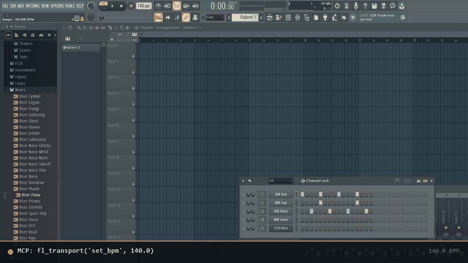

# fl-studio-mcp

[](https://github.com/Arnau10a/fl-studio-mcp/actions/workflows/ci.yml)
[](https://www.python.org/downloads/)
[](LICENSE)

A bidirectional **Model Context Protocol (MCP)** server for controlling **FL Studio** from AI assistants. It combines a custom **chunked MIDI SysEx RPC bridge** inside FL Studio's sandboxed Python runtime, **Win32 GUI automation** for actions outside the official scripting API, **Hard Techno MIDI/WAV synthesis**, **DSP audio analysis**, and an **in-memory FL Studio simulator** (`FL_MCP_MOCK=1`) for cross-platform testing without a live DAW.

---

## Architecture

```
┌──────────────────┐   stdio (MCP)   ┌──────────────────────────────────┐
│  AI / MCP Client │ ◄─────────────► │       fl_studio_mcp.server       │
└──────────────────┘  Tools (29)     │  • 29 Tools, 4 Resources, 2 Prompts
                      Resources (4)  └───────────┬────────────┬─────────┘
                      Prompts (2)                │            │
                                  Live Mode      │            │ FL_MCP_MOCK=1
                         ┌───────────────────────┘            ▼
                         │                          ┌──────────────────┐
              SysEx JSON │  Win32 SendInput         │  MockFLRuntime   │
              (FLBridge) │  (win_auto)              │ (loads real      │
                         ▼                          │  device script)  │
         ┌──────────────────────────────┐           └──────────────────┘
         │   loopMIDI Virtual Ports     │
         │  • FL_MCP_IN  (PC -> FL)     │
         │  • FL_MCP_OUT (FL -> PC)     │
         └──────────────┬───────────────┘
                        ▼
         ┌──────────────────────────────┐
         │  FL Studio MIDI Controller   │
         │  fl_script/device_FLStudioMCP│
         └──────────────────────────────┘
```

For protocol framing details, Win32 fallback boundaries, and design trade-offs, see [`docs/ARCHITECTURE.md`](docs/ARCHITECTURE.md).

---

## Quick Try Without FL Studio (`FL_MCP_MOCK=1`)

Anyone can run and test the entire MCP server (including real SysEx chunking/reassembly against `device_FLStudioMCP.py`) on **Windows, macOS, or Linux** without FL Studio or `loopMIDI`:

```bash
git clone https://github.com/Arnau10a/fl-studio-mcp.git
cd fl-studio-mcp
uv sync
```

Run the full test suite, linter, and static type checker:

```bash
uv run ruff check .
uv run mypy src
uv run pytest -v
```

Or point your MCP client to the server with `FL_MCP_MOCK=1`:

```json
{
  "mcpServers": {
    "fl-studio": {
      "command": "uv",
      "args": ["--directory", "/path/to/fl-studio-mcp", "run", "fl-studio-mcp"],
      "env": { "FL_MCP_MOCK": "1" }
    }
  }
}
```

---

## Demo



Run the self-contained mock session from the demo yourself (no FL Studio required):

```bash
uv run python examples/demo_session.py
```

---

## MCP Capabilities

### Tools (32)

| Category | Tools |
| --- | --- |
| **Diagnostics & Transport** | `fl_doctor`, `fl_list_midi_ports`, `fl_ping`, `fl_transport`, `fl_undo` |
| **Channel Rack & Step Sequencer** | `fl_channels_list`, `fl_channel_set` (with `#RRGGBB` color), `fl_step_sequencer`, `fl_step_sequencer_get`, `fl_channel_editor`, `fl_midi_note` |
| **Piano Roll Scripting** | `fl_piano_roll_notes`, `fl_piano_roll_state`, `fl_piano_roll_clear` |
| **Patterns & Playlist** | `fl_patterns`, `fl_playlist_list`, `fl_playlist_set` |
| **Mixer, EQ & Plugins** | `fl_mixer_list`, `fl_mixer_set` (color, stereo separation, arming), `fl_mixer_eq`, `fl_plugin_params`, `fl_plugin_set` |
| **Win32 GUI & Sample Browser** | `fl_ui_focus`, `fl_add_plugin`, `fl_search_samples`, `fl_load_sample`, `fl_import_midi`, `fl_new_project`, `fl_delete_channel` |
| **Hard Techno DSP & Feedback** | `ht_generate_midi`, `ht_generate_kick_sample`, `fl_analyze_audio` |

### Resources (4)
- `fl://session/state` — Live BPM, transport state, active pattern, channel & mixer counts
- `fl://channels/rack` — Full Channel Rack snapshot (names, plugins, volumes, pans, routing)
- `fl://mixer/tracks` — Mixer tracks overview (volumes, peaks, mute/solo, loaded FX)
- `fl://samples/output` — Inventory of generated `.mid` and `.wav` files in `output/`

### Prompts (2)
- `hard_techno_drop` — End-to-end Hard Techno drop workflow with DSP verification
- `mix_gain_staging` — Gain-staging and low-end EQ audit workflow

---

## Live FL Studio Setup (Windows)

### 1. Create Virtual MIDI Ports (`loopMIDI`)

Install and open [loopMIDI](https://www.tobias-erichsen.de/software/loopmidi.html), then create two virtual ports:

- `FL_MCP_IN`
- `FL_MCP_OUT`

*(Override port names anytime via `FL_MCP_IN_PORT` and `FL_MCP_OUT_PORT`.)*

### 2. Install Dependencies & FL Studio Scripts

One-command PowerShell installer (installs `uv` if needed, dependencies, Hardware + Piano Roll scripts, and runs `fl-studio-mcp-doctor`):

```powershell
.\install.ps1
```

Or manually:

```powershell
uv sync
uv run python scripts/install_fl_script.py
```

This copies `fl_script/device_FLStudioMCP.py` into `~/Documents/Image-Line/FL Studio/Settings/Hardware/FLStudioMCP/` and `fl_script/FLStudioMCP_PianoRoll.pyscript` into `~/Documents/Image-Line/FL Studio/Settings/Piano roll scripts/`.

### 3. Configure FL Studio MIDI Settings

In FL Studio (**Options -> MIDI Settings**):
1. Under **Output**, select `FL_MCP_OUT` and assign a **Port** number (e.g. `10`).
2. Under **Input**, select `FL_MCP_IN`:
   - Toggle **Enable** ON.
   - Set **Controller type** to **`FLStudioMCP`**.
   - Set **Port** to the **same Port number** (`10`).

### 4. Verify Connection with `fl-studio-mcp-doctor`

```powershell
uv run fl-studio-mcp-doctor
```

Checks Python environment, controller script SHA-256 parity, `loopMIDI` ports, FL Studio window detection, and live SysEx `ping` latency.

### 5. Register the MCP Server

```json
{
  "mcpServers": {
    "fl-studio": {
      "command": "C:\\path\\to\\fl-studio-mcp\\.venv\\Scripts\\python.exe",
      "args": [
        "C:\\path\\to\\fl-studio-mcp\\server.py"
      ]
    }
  }
}
```

*(Both `server.py` at the repo root and the installed `fl-studio-mcp` script entrypoint are supported.)*

---

## Project Structure

```text
fl-studio-mcp/
├── src/fl_studio_mcp/
│   ├── server.py              # MCP server (29 tools, 4 resources, 2 prompts)
│   ├── bridge.py              # Thread-safe bidirectional SysEx RPC client
│   ├── simulator.py           # In-memory FL Studio runtime (FL_MCP_MOCK=1)
│   ├── win_auto.py            # Win32 SendInput GUI automation & sample search
│   ├── hard_techno.py         # Vectorized kick/rumble WAV & MIDI synthesis
│   ├── audio_analysis.py      # WAV peak/RMS/clipping & FFT spectral analyzer
│   ├── doctor.py              # Setup & connectivity diagnostics CLI
│   └── paths.py               # Centralized path resolution
├── fl_script/
│   └── device_FLStudioMCP.py  # FL Studio MIDI Controller script (OnSysEx RPC)
├── scripts/
│   └── install_fl_script.py   # Installer for FL Studio Hardware folder
├── examples/
│   └── uptempo_190bpm.py      # Standalone 48-bar 190 BPM MIDI + WAV generator
├── docs/
│   └── ARCHITECTURE.md        # Protocol spec & engineering trade-offs
├── tests/                     # E2E protocol, MCP, DSP & doctor pytest suite
├── server.py                  # Backward-compatible root launcher shim
├── pyproject.toml
├── uv.lock
└── LICENSE
```

---

## License

[MIT](LICENSE)
